<div align="center">


# G-one
### A personal health companion that thinks on the phone

A wrist-worn sensor, an Android app, fifteen deterministic health rules, three small trained models
and a 1.5-billion-parameter language model, all running on the phone. Official disaster alerts,
city weather and India's air-quality index around it. Emergency help when it matters.

**Kotlin · Jetpack Compose · ESP32-S3 · Bluetooth LE · LiteRT · llama.cpp · Room · TensorFlow**

[What's new](#whats-new-october-2026) · [How it works](#how-it-works) · [Features](#features) · [Trained models](#trained-models) · [Performance](#performance-and-evidence) · [Build](#build-and-run) · [Docs](#documentation)

[Website](https://g--one.vercel.app/) · [Web demo](https://g--one.vercel.app/demo) · [Hardware explorer](https://g--one.vercel.app/hardware)

</div>

<table>
<tr>
<td align="center" width="25%"><strong>RULES DECIDE</strong><br/>15 named, tested rules raise every alert</td>
<td align="center" width="25%"><strong>MODELS ARE SENSORS</strong><br/>3 trained INT8 models, 5–15 KB each</td>
<td align="center" width="25%"><strong>AI ONLY REWORDS</strong><br/>On-phone LLM; alerts never wait for it</td>
<td align="center" width="25%"><strong>NOTHING LEAVES UNASKED</strong><br/>Every network feature is opt-in</td>
</tr>
</table>

---

## At a glance

| | |
|---|---|
| **App** | Native Android, package `com.gone.ai`, API 24+, ARM64 |
| **Wearable** | ESP32-S3 strap: pulse/SpO₂ (MAX30100), skin temperature (DS18B20), motion (MPU6050, ±8 g), muscle activity (EMG) |
| **Detection** | 15 deterministic rules with duration windows, cooldowns, a personal baseline and 0–100 risk scores |
| **Trained models** | Fall detector, heart rate in context, sleep or awake: INT8 TensorFlow Lite through LiteRT, tested on held-out people |
| **Language model** | Qwen2.5-1.5B-Instruct Q4_K_M via llama.cpp on the CPU; pinned by SHA-256 |
| **Around you** | NDMA SACHET disaster alerts for your district, city weather for the heat rules, India AQI (CPCB) |
| **Emergency** | Automatic SMS (+ optional call) on live anomalies, falls sent at once by default, NFC/QR emergency ID |
| **Storage** | App-private Room database (schema 5), preferences, files |
| **Evidence** | 659 JVM tests and 32 on-device tests passing; Python spec tests; protocol self-test; bench sessions on the real strap ([VERIFICATION.md](VERIFICATION.md)) |
| **Stage** | Working prototype. Not a medical device and not clinically validated |

## Contents

- [What's new (October 2026)](#whats-new-october-2026)
- [Visual tour](#visual-tour)
- [The problem and who it is for](#the-problem-and-who-it-is-for)
- [How it works](#how-it-works)
- [Features](#features)
- [Trained models](#trained-models)
- [Your area: disaster alerts, weather, India AQI](#your-area-disaster-alerts-weather-india-aqi)
- [Hardware and protocol](#hardware-and-protocol)
- [Implementation details](#implementation-details)
- [Privacy and what leaves the phone](#privacy-and-what-leaves-the-phone)
- [Technology stack](#technology-stack)
- [Performance and evidence](#performance-and-evidence)
- [Footprint and compression](#footprint-and-compression)
- [Design comparisons](#design-comparisons)
- [Build and run](#build-and-run)
- [Repository map](#repository-map)
- [Advantages, limits and next steps](#advantages-limits-and-next-steps)
- [Documentation](#documentation)

---

## What's new (October 2026)

An outside review of public SIH26181 projects ranked G-one's app among the best but named its gaps:
no trained model, no disaster feed, no real environment input, no way to cancel a fall SOS, no
Qualcomm angle, and a repository that could not be rebuilt or reused. This release answers each.

| Gap named | What changed | Where |
|---|---|---|
| No trained model | **Three trained models**, each tested on people it never saw, with honest baselines. The heart-rate model drives a new rule, `ml.hrContext`, in live monitoring | [`ml/`](ml/README.md), [`docs/MODELS.md`](docs/MODELS.md), `app/.../ml/` |
| No disaster alerts | **Official NDMA SACHET alerts** for the wearer's district, notified once, cached offline, with what-to-do guidance | [`docs/DISASTER-ALERTS.md`](docs/DISASTER-ALERTS.md), `health/disaster/` |
| Heat rules had no environment; AQI on the US scale only | **City weather feeds the heat rules** when the strap has no sensor (capped, labelled, never an SOS); **India AQI** computed by CPCB's method; forecast hints in IMD's terms | `health/environment/` |
| No "I'm OK" before the SOS | **Falls only** wait 20 s (10/20/30 s or "at once") with an alarm and an "I'm OK" button; every other alert still sends at once | [`docs/SOS_BEHAVIOR.md`](docs/SOS_BEHAVIOR.md) |
| Sleep typed, not sensed | **Estimated sleep** from wrist movement on the Sleep card, offered as a pre-filled diary entry | `com.gone.ai.ml.SleepEstimator` |
| No Qualcomm angle | **All three models profiled on real Snapdragon phones through Qualcomm AI Hub: every layer runs on the NPU**, 41–55 µs per run on 8 Gen 3 and 8 Elite. The vendored llama.cpp already carries the Adreno OpenCL and Hexagon backends for the language model (not yet used) | [`ml/aihub/profile.py`](ml/aihub/profile.py), [`ml/reports/aihub/`](ml/reports/aihub) |
| Model not reproducible | **`tools/fetch_model.ps1`** downloads the exact language model (pinned revision, size, SHA-256); the workspace copy matches byte for byte | [`app/src/main/assets/models/README.md`](app/src/main/assets/models/README.md) |
| No licence; logs committed | **MIT licence**, `NOTICE` for every dataset and dependency, logs ignored, **CI** for tests, lint and model specs | `LICENSE`, `NOTICE`, `.github/workflows/ci.yml` |
| — | **Model Lab** screen: each model's tests, timing on this phone, and something to try (replay, live phone sensor, a recorded session, a recorded night) | Tools → Model Lab |
| — | Fixes from a code audit: emergency page escapes typed fields; fall rewrites no longer rejected; stale fall wording, comments and test names corrected | — |

[Back to contents](#contents)

## Visual tour

<table>
<tr>
<td width="50%"><a href="https://g--one.vercel.app/">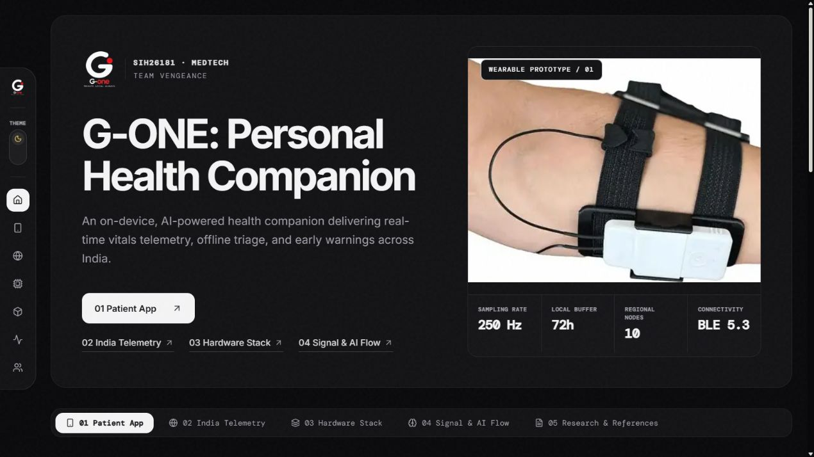</a><br/><strong>Project website</strong></td>
<td width="50%"><a href="https://g--one.vercel.app/demo">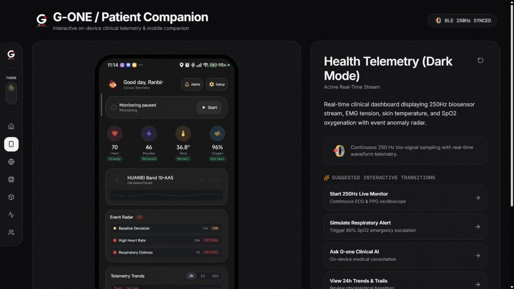</a><br/><strong>Patient companion demo (browser)</strong></td>
</tr>
<tr>
<td width="50%"><a href="docs/assets/phase1-worn.png">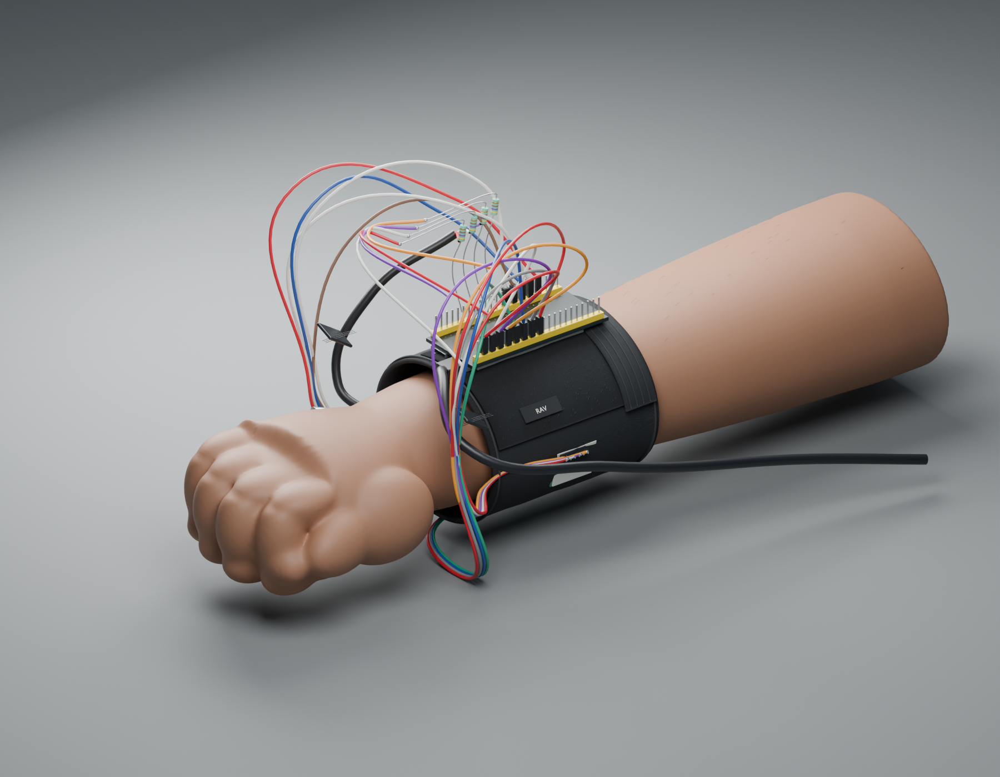</a><br/><strong>Phase 1 strap</strong> — Blender reconstruction of the real prototype</td>
<td width="50%"><a href="docs/assets/pcb-concept.png">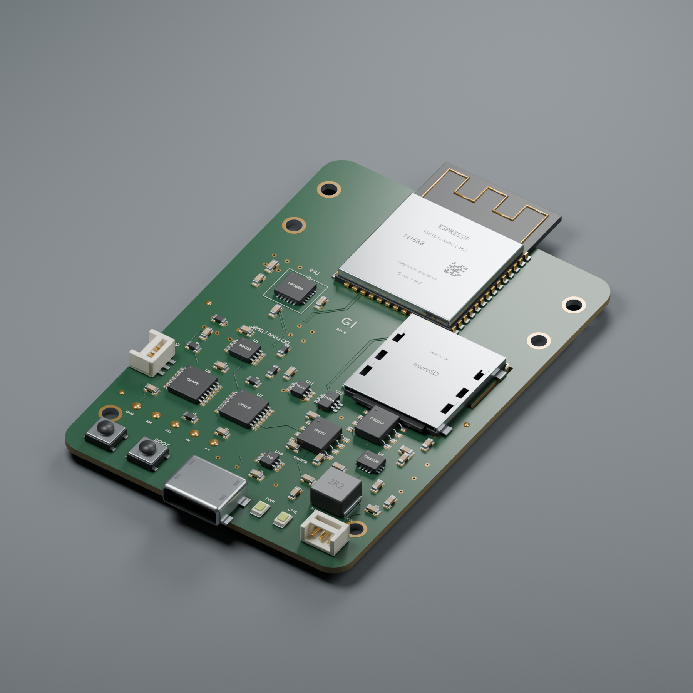</a><br/><strong>Compact PCB concept</strong> — a design study, not fabricated</td>
</tr>
</table>

<details>
<summary><strong>More: Android screens, hardware explorer, Jeevan Core concept</strong></summary>

<table>
<tr>
<td width="33%" align="center">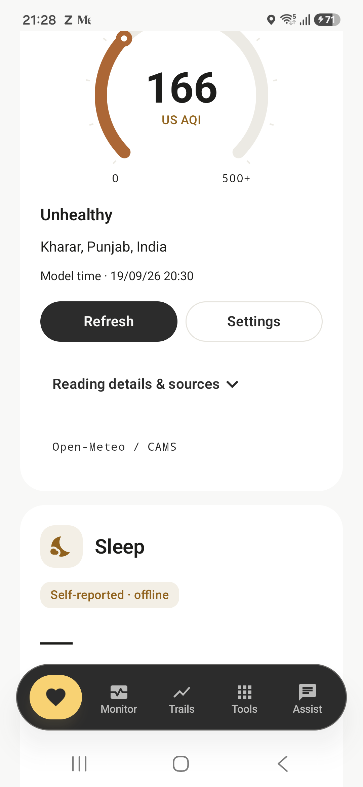<br/>Air quality card</td>
<td width="33%" align="center">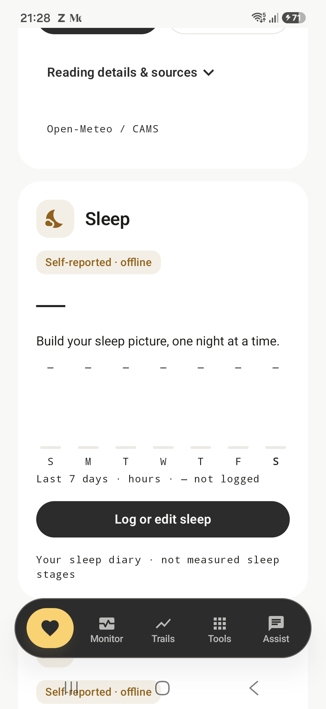<br/>Sleep journal</td>
<td width="33%" align="center">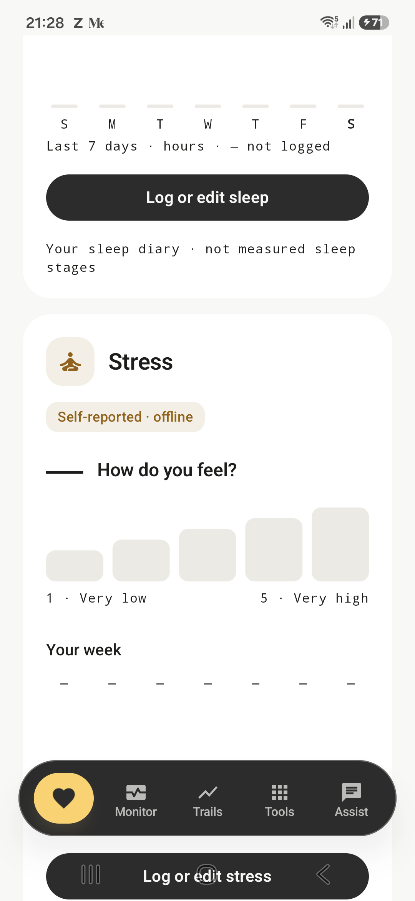<br/>Stress check-in</td>
</tr>
</table>

<p align="center"><a href="https://g--one.vercel.app/hardware">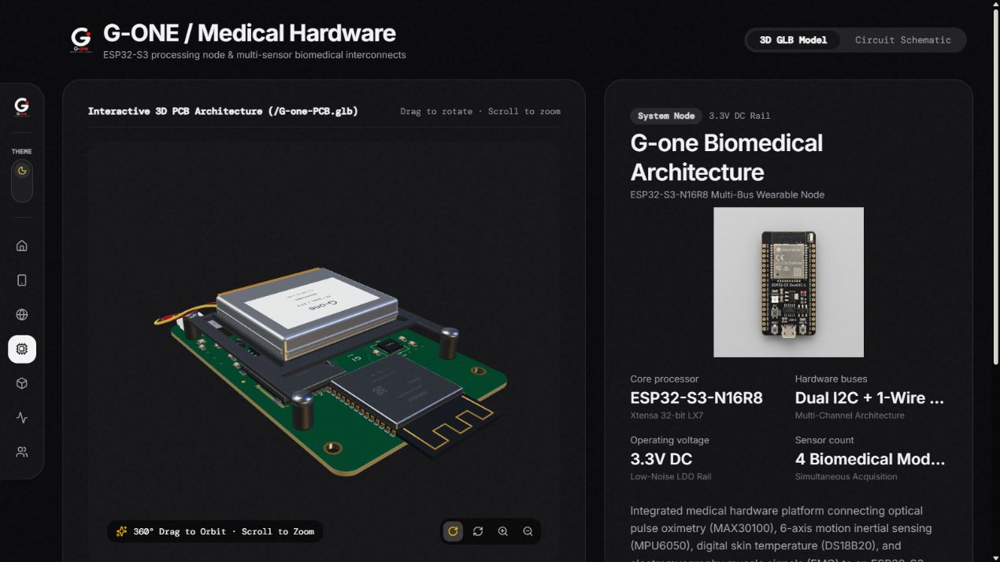</a> <a href="docs/assets/core-exploded.png"></a></p>

Website captures are from 22 September 2026; app screenshots are earlier captures from the
repository's artifacts; renders are Blender concepts. The website describes an intended product
(for example "72-hour buffer"); this README describes the build. [Image sources](docs/assets/README.md#visual-gallery-provenance).

</details>

## The problem and who it is for

Health care goes quiet after a hospital visit, and in much of India the network does too. G-one
keeps watching when nobody else is: it measures, decides and explains **on the phone**, and only
reaches out (a text to family, an alert feed, the weather) when the wearer has switched that on.

| Who | What G-one gives them | Boundary |
|---|---|---|
| Someone recently discharged | Continuous readings, trends, a personal baseline and plain-language alerts | Engineering thresholds, not a clinical protocol |
| An older person living alone | Fall alarm with an "I'm OK" window, automatic text to family, NFC emergency ID | The 5 g fall gate can miss gentle falls |
| A family member far away | An SMS when a live reading is confirmed abnormal | Needs SIM, signal and the wearer's opt-in |
| Anyone in a heat wave, flood or storm | Official district alerts with what to do; heat rules that know the city's weather | Alerts depend on SACHET and a network to fetch them |
| Rural use with weak connectivity | Detection, alerts, the language model and OCR all work offline | Alerts and weather are cached, not live, offline |
| Anyone with a report to understand | OCR, PDF summaries, quizzes and chat with a local model | Generated text can be wrong |
| Developers and evaluators | Simulator, protocol emulator, Model Lab, golden-file tests | Simulated data can never send an SOS |

## How it works

### The architecture

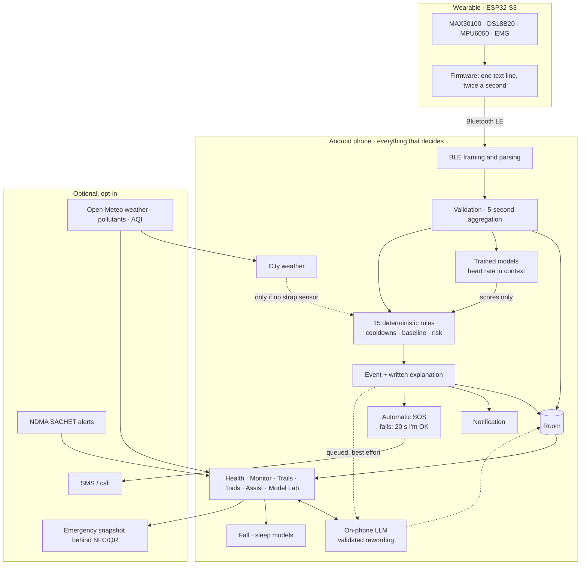

| Layer | Responsibility | Code |
|---|---|---|
| Source | Framing, units, ranges, reconnects, clock sync | `health/source/`, `health/source/ble/` |
| Pipeline | Store → detect → store event → alert → queue rewrite, in that order | `health/service/MonitoringPipeline.kt` |
| Detection | 15 rules, thresholds, baseline, risk scores, model signals; pure Kotlin | `health/detect/`, `health/domain/` |
| Models | Feature code (twin of the Python spec), LiteRT runner, manifest with checksums | `com/gone/ai/ml/` |
| Explanation | Templates first; LLM rewrite validated against the measured numbers | `health/explain/` |
| Emergency | SOS policy and coordinator, NFC/QR emergency ID | `health/sos/`, `health/emergency/`, `health/nfc/` |
| Area | SACHET alerts, weather, India AQI, background check | `health/disaster/`, `health/environment/` |
| Language model | Shared llama.cpp runtime, leases, prompt budgets | `ai/`, `app/src/main/cpp/` |

### A reading becomes an alert

```mermaid
sequenceDiagram
    participant W as Wearable
    participant P as Pipeline
    participant R as Room
    participant H as HR model
    participant D as Rules
    participant U as Wearer
    participant S as SOS
    participant L as LLM
    W->>P: HR:72,SPO2:97,STEMP:33.9,MOT:1.02,...
    P->>P: parse, validate, 5-s bucket
    P->>R: 1 · store the reading
    P->>H: expected heart-rate band (if a resting rate is known)
    P->>D: 2 · evaluate 15 rules over the window
    D-->>P: confirmed anomaly, or nothing
    P->>R: 3 · store the event with its written explanation
    P->>U: 4 · notify now
    P->>S: eligible? fall → 20 s "I'm OK"; others → send in 1.5 s
    P->>L: 5 · queue a rewording (never waited for)
    L-->>R: validated rewrite, or the template stays
```

**The order is the safety property.** A slow, missing or wrong language model cannot delay or
change an alert; a failed write cannot stop detection; a model that fails its checksum only
silences its own rule.

### An official alert reaches the wearer

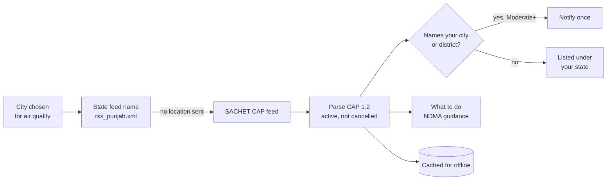

### A document becomes understandable

Pick an image, a PDF or a screenshot → text is extracted on the phone (ML Kit OCR, the PDF text
layer, or render-then-OCR) → the local model summarises, explains or makes a quiz within its token
budget → the result can be saved to the Memory Vault or sent to Assist.

## Features

### Health monitoring

| Feature | What it does |
|---|---|
| Live monitoring | Bluetooth link with back-off reconnects and a 10 s stale-link watchdog; source-aware charts; missing values shown as missing |
| Sessions and reports | Record a stretch of monitoring; build a report and a PDF from what was actually stored |
| Personal baseline | Resting heart rate, typical SpO₂ and temperature from your own readings at rest |
| Risk scores | Heat, respiratory and cardiovascular indicators, 0–100, every reading |
| EMG calibration | Per-wearer muscle levels; raw ADC numbers are not universal |
| Simulator | Ten scenarios for demos and tests; simulated readings never send an SOS |
| Emergency ID | Choose fields, write a stable link to an NFC tag or show a QR; the record behind it updates |

### The 15 rules

| Rule ID | Watches for | Highest severity |
|---|---|---|
| `spo2.critical` / `spo2.sustained` | Critically low oxygen / below 92 % for 10 minutes | CRITICAL / MODERATE |
| `hr.high` / `hr.low` | Fast heart rate (130+ at rest, 150+ anytime) / slow at rest | CRITICAL |
| `temp.fever` | Raised **core** temperature, when a core sensor exists | CRITICAL |
| `temp.skinHigh` | Skin temperature 37.5 °C (MODERATE) or 39 °C (CRITICAL) | CRITICAL |
| `env.heatStress` / `env.dehydrationRisk` | Heat plus a body response; city weather allowed when the strap has none (then MODERATE at most) | CRITICAL / MODERATE |
| `resp.distress` / `cardio.strain` | Poor air with low oxygen; falling oxygen with rising heart rate | CRITICAL / MODERATE |
| `motion.fall` | An impact of 5 g or more on the newest reading | CRITICAL |
| `wellness.fatigue` | Raised resting heart rate over a long stretch | LOW |
| `baseline.deviation` | Within normal ranges but away from your own normal | MODERATE |
| `emg.sustainedHigh` | Muscles held tense at rest; rail readings ignored | MODERATE |
| **`ml.hrContext`** (new) | Heart rate well above what recent movement explains (trained model) | MODERATE, never SOS |

Every rule is a pure function with tests for firing **and** staying silent. Per-type 15-minute
cooldowns stop repeats but let a worse event through. Thresholds:
[`AnomalyThresholds.kt`](app/src/main/java/com/gone/ai/health/domain/AnomalyThresholds.kt).

### Emergency SOS

| Alert | What happens |
|---|---|
| Possible fall (impact ≥ 5 g) | Sent at once by default. Settings can put back a 10, 20 or 30 s **"I'm OK, don't send"** countdown with alarm and vibration |
| Any other confirmed live anomaly | SMS after 1.5 s (alerts on one reading are combined); optional call 5 s later |
| A fall, then another alert within 1.5 s | One message carries both reasons |
| Never sends | Simulated or replayed readings; the `ml.hrContext` early warning; heat findings that rest on city weather |

Details and remaining physical tests: [`docs/SOS_BEHAVIOR.md`](docs/SOS_BEHAVIOR.md).

### Assist and tools

| Tool | What it does |
|---|---|
| Assist | Streaming local chat with formatting, stop/retry, history, voice, and optional personal health context |
| OCR · PDF summary · Screenshot AI | Text from images, documents and screens, summarised locally |
| Circle to Search | Select part of the screen and ask about it |
| Quiz generator | Questions, answers and a score from any text |
| Memory Vault | Saved scans, summaries and quizzes; full-text search; choose which ones Assist may use |
| **Model Lab** (new) | The three trained models: what they learned from, how they tested, timing on this phone, and a try-it for each |
| Wellness | Sleep diary with **estimated sleep** from the wearable, stress check-ins, reminders |

General chat is not held to the strict validation used for health alerts and can be wrong.

## Trained models

Three small models, trained on public datasets in [`ml/`](ml/README.md), tested on people they
never saw, exported as INT8 TensorFlow Lite and run by LiteRT. A model produces a score; a rule
decides. Full method, figures and limits: [`docs/MODELS.md`](docs/MODELS.md).

| Model | Learns | Data | Size | Held-out result | Baseline on the same data |
|---|---|---|---|---|---|
| **Fall detector** | Fall or not, from 4 s around an impact | WEDA-FALL + UMAFall, 44 people, 3,078 recordings | 15.0 KB | **96.2 %** falls caught, **95.9 %** activities with no alarm | 5 g rule: 50.7 % / 89.6 % |
| **Heart rate in context** | Heart rate expected for the last 5 min of movement | PAMAP2, 9 people | 4.7 KB | **2.2** false alarms a day on healthy people | Fixed heart-rate rule: 51.6 a day |
| **Sleep or awake** | Asleep or awake every 30 s from wrist movement | Walch et al. (PhysioNet), 31 lab-scored nights | 6.5 KB | Cohen's kappa **0.46**; total sleep within **17.4 min** a night | Movement threshold: kappa 0.37, 19.7 min |

<table>
<tr>
<td width="50%">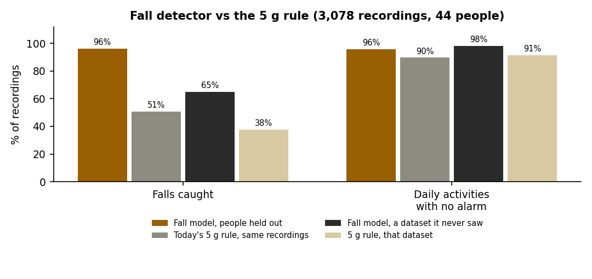</td>
<td width="50%">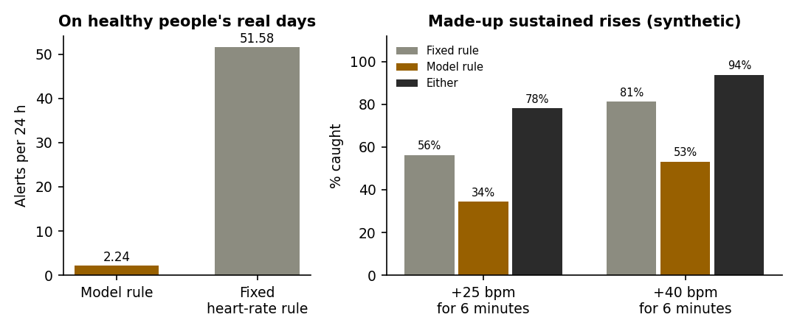</td>
</tr>
<tr>
<td width="50%">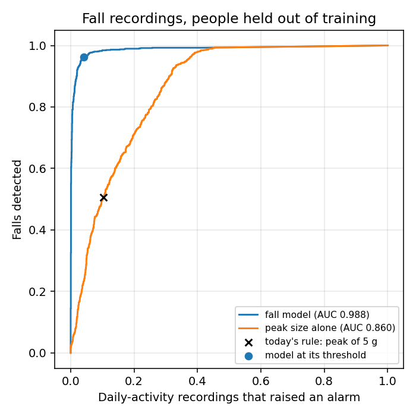</td>
<td width="50%">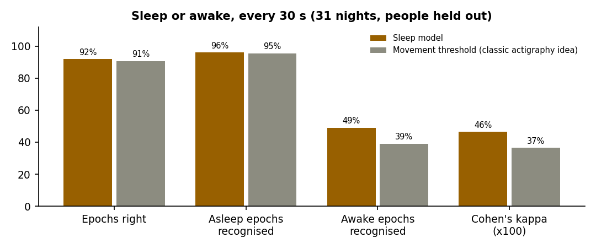</td>
</tr>
</table>

**Read these honestly.**
- On a fall dataset it never saw, the fall model catches **64.8 %** of falls (the 5 g rule:
  37.7 %). That is the fairer number for new hardware.
- The **strap cannot feed the fall model yet**: it sends one peak value twice a second, not a
  movement window, so strap falls still use the 5 g rule. The model runs in the Model Lab on the
  phone's own sensor and on recordings; sending the window from the firmware is the next step.
- The heart-rate model is about as accurate as a straight line (14.1 vs 14.2 bpm error); its value
  is the conservative rule built on it, and it is an early hint that never sends an SOS. The strap
  delivers no heart rate until its missing pull-up resistors are fitted.
- Every model's inputs are computed by Kotlin code that tests prove identical to the Python code
  that trained it, on real recordings ("golden files").

## Your area: disaster alerts, weather, India AQI

Opt-in, using the city chosen for air quality. Full description: [`docs/DISASTER-ALERTS.md`](docs/DISASTER-ALERTS.md).

| Part | Source | Behaviour |
|---|---|---|
| Official alerts | NDMA **SACHET** CAP 1.2 feeds | State feed downloaded, district matched on the phone, new Moderate+ alerts for the district notified once, cached offline, with NDMA-based guidance per hazard |
| City weather | Open-Meteo | Shown with feels-like, humidity, UV; used by the heat rules **only** when the strap has no thermometer (≤ 90 min old, MODERATE at most, labelled, no SOS) |
| Forecast hints | Open-Meteo daily forecast | Heavy / very heavy / extremely heavy rain (64.5 / 115.6 / 204.5 mm) and heat-wave level heat (45 / 47 °C), labelled as not official |
| India AQI | Open-Meteo pollutants | CPCB National AQI from 24-h and 8-h means, with the dominant pollutant |

## Hardware and protocol

| Part | Measures | Connection |
|---|---|---|
| ESP32-S3-N16R8 | — | Runs the firmware, Bluetooth LE (NimBLE), 80 MHz, 3 dBm |
| MAX30100 | Pulse, SpO₂ | I²C bus 0, GPIO 8/9, own task on core 0 |
| MPU6050 | Movement, impacts (±8 g) | I²C bus 1, GPIO 6/7 |
| DS18B20 | Skin temperature | 1-Wire, GPIO 4 |
| EMG module | Muscle activity | ADC, GPIO 1 |

The link is the HM-10 serial profile (`FFE0`/`FFE1`), newline-framed `KEY:VALUE` lines such as
`HR:72,SPO2:97,STEMP:33.90,MOT:1.02,EMG:1234,EMGPK:1810,EMGBITS:12,ST:5D,TS:…`, units and ranges
checked by the app; the phone sets the wearable's clock with `T:<epoch ms>`. The app and the
emulator also speak an acknowledged store-and-forward protocol (`SEQ`, `ACK`, `LOST`); **the
current firmware is live-only**, so readings made out of range are lost.
[Protocol](docs/WEARABLE_PROTOCOL.md) · [Hardware setup](docs/HARDWARE_SETUP.md) · design models in [`hardware/`](hardware) (renders, not fabricated boards).

## Implementation details

**Model runtime.** `ModelRegistry` reads `assets/ml/manifest.json`, checks each `.tflite`
against its SHA-256 and refuses a mismatch; `TfliteScorer` runs it on LiteRT with two CPU threads.
Feature code (`FallWindow`, `HrContextFeatures`, `SleepFeatures`) is pure Kotlin, a twin of
`ml/common/*.py`. Golden files written by the training scripts make the JVM tests compare the two
on real recordings; `ModelOnDeviceTest` compares LiteRT's outputs with training's on a phone, and
`AreaLiveNetworkTest` checks the weather, air-quality and SACHET clients against the live services.

**Model signals in detection.** The pipeline asks the heart-rate model for a band at each live
reading (only with a reliable resting rate), keeps the bands for the window, and passes them to the
detector as `ModelSignals`. A model that throws or is missing leaves its rule silent.

**Language model lifecycle.** A C++ JNI bridge over vendored llama.cpp; one shared instance with
leases, released 60 s after the last one closes; requests serialised and cancellable; prompt prefix
reused through the KV cache. Health rewrites are validated: any number not actually measured,
any advice or diagnosis, or meta-text rejects the rewrite and the template stays.

**SOS coordinator.** A pure-Kotlin state machine: falls wait their window, other reasons cut it
short, alerts within 1.5 s merge, sending survives monitoring being stopped, every attempt is recorded.

**Area repository.** Pure Kotlin behind `AreaClient`/`AreaStore`: one part failing keeps the
others; refreshes throttled (15 min, 1 min after a failure); alerts kept until they expire; each
announced once. The XML parser refuses DTDs and external entities; only SACHET addresses are fetched.

**Persistence.** Room with exported schemas and hand-written additive migrations (version 5,
unchanged in this release); 7-day reading retention; preferences and atomic files for the rest.

## Privacy and what leaves the phone

"Local" means the decisions are local. It does not mean the database is encrypted.

| Path | Default | What can leave the phone |
|---|---|---|
| Detection, trained models, language model, OCR | On, local | Nothing |
| Readings, sessions, reports, Vault, diary | On, local | Only what the wearer exports or shares |
| Air quality, weather, India AQI | Off | City coordinates to Open-Meteo (and the request's IP address) |
| Official alerts | Off | The name of the state's public feed to SACHET; no location |
| Emergency snapshot | Off | The fields the wearer picks |
| Automatic SOS | Off | SMS and optional call to the saved contact, via the carrier |
| Voice | On request | May use online recognition if no offline pack exists |
| Model timing (developer) | Manual | The `.tflite` files (public-data models) to Qualcomm AI Hub, by the developer |

The database is app-private SQLite, **not encrypted**; cloud backup is off.

## Technology stack

<details>
<summary><strong>Stack illustration</strong> (drawn before this release; the table below adds LiteRT, TensorFlow training and the SACHET feed)</summary>

<p align="center">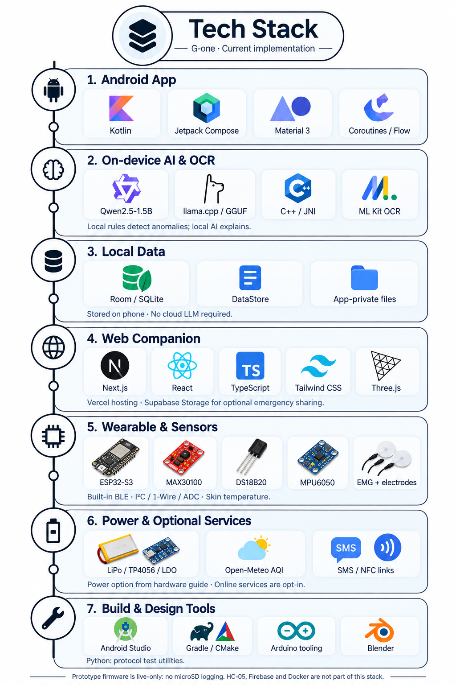</p>

</details>

| Layer | Technology |
|---|---|
| Language and UI | Kotlin 2.0.21 · Compose BOM 2024.09.00 · Material 3 · Navigation 2.8.9 |
| State and data | ViewModel · coroutines and Flow · Room 2.7.1 (schema 5) · DataStore 1.1.7 |
| On-device ML | **LiteRT 1.4.2** (TensorFlow Lite) for the three INT8 models |
| Language model | llama.cpp/ggml (vendored, C++17, JNI, ARM NEON) · Qwen2.5-1.5B-Instruct Q4_K_M |
| Recognition, QR, animation | ML Kit text recognition 16.0.1 · ZXing 3.5.3 · Lottie 6.6.2 |
| Optional services | NDMA SACHET CAP feeds · Open-Meteo weather, air quality and geocoding · a separate Next.js site for emergency snapshots |
| Build | AGP 8.10.1 · Gradle 8.11.1 · SDK 36 · NDK 28.2.13676358 · CMake 3.22.1 |
| Model training | Python 3.11 · TensorFlow 2.20 · scikit-learn 1.5 · Qualcomm AI Hub client 0.56 |
| Firmware | ESP32 Arduino core · NimBLE-Arduino 2.x · MAX30100lib · OneWire/DallasTemperature |
| Quality | JUnit (JVM) · AndroidX instrumentation · Android lint · pytest · GitHub Actions |

## Performance and evidence

Measured artifacts and recorded observations only. Not a clinical evaluation.

| Evidence | Result | Scope |
|---|---|---|
| JVM unit tests | **659 tests, 74 classes, 0 failures**; lint 0 errors (55 warnings) | `testDebugUnitTest`, run 3 October 2026 |
| On-device tests | **32 of 32** on a Samsung SM-S721B (Android 16): migrations, screen-reader labels, layout, model outputs equal to training's, live weather / India AQI / SACHET | `am instrument`, 4 October 2026 |
| Model speed on the phone | Fall 15–27 µs, heart rate 9 µs, sleep 18 µs per run (CPU, median of 200) | Model Lab on the SM-S721B |
| Model speed on Snapdragon | 41–55 µs per run on Galaxy S24 (8 Gen 3) and S25 (8 Elite); **all layers on the NPU** | Qualcomm AI Hub hosted phones, 4 October 2026 |
| Python checks | 9 spec and checksum tests passed; protocol self-test 10 of 10 checks passed | `pytest ml/tests`; `emulate.py --selftest` |
| Fall model, people held out | 96.2 % caught · 95.9 % no alarm · AUC 0.988 | 5-fold by person, 3,078 recordings |
| Fall model, unseen dataset | 64.8 % caught · 98.1 % no alarm | Trained on WEDA-FALL, tested on UMAFall |
| Heart-rate rule | 2.2 false alarms a day (fixed rule 51.6); +25/+40 bpm rises caught 34 %/53 % alone, 78 %/94 % with the fixed rule | Leave one person out, 10.7 h |
| Sleep model | 91.9 % of epochs right, 49 % of awake epochs found, kappa 0.46, total-sleep error 17.4 min (movement threshold: 90.7 %, 39 %, 0.37, 19.7 min; always "asleep": 91.5 %) | 5-fold by person |
| 8-bit vs float | Fall: 7 of 5,334 decisions differ; sleep: 7 of 5,000; heart rate: 0.57 bpm mean difference | Shipped INT8 vs float on training data |
| Debug APK | 1,238,436,040 bytes (1.15 GiB): language model 90.2 %, LiteRT native library 4.5 MB, the three models and their demo recordings under 0.2 MB | This build |
| Language model file | 1,117,320,736 bytes, SHA-256 `6a1a2eb6…407e`, matches the official file | Hashed 2 Oct 2026 |
| Prompt processing | 28.9 tokens/s | One recorded quiz prefill on a Samsung SM-S721B (historical) |
| Strap, on the bench | 19-minute session stored and reported; every report figure matched the database; a 9.47 g jolt raised a fall alert | [VERIFICATION.md](VERIFICATION.md) |

**Not measured yet:** the language model on a Snapdragon NPU or GPU (it runs on the CPU), the
fall countdown and a real SMS on the strap, sustained LLM generation speed, battery, heat, and
anything on patients.

### Time per run, measured

<p align="center">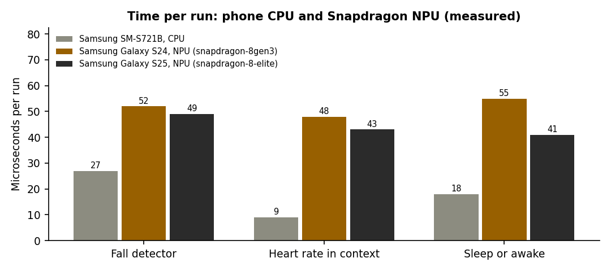</p>

| Model | Galaxy S24 (Snapdragon 8 Gen 3) | Galaxy S25 (Snapdragon 8 Elite) | Layers on the NPU | SM-S721B (Exynos), CPU |
|---|---|---|---|---|
| Fall detector | 52 µs | 49 µs | 12 of 12 | 15–27 µs |
| Heart rate in context | 48 µs | 43 µs | 5 of 5 | 9 µs |
| Sleep or awake | 55 µs | 41 µs | 6 of 6 | 18 µs |

Every layer of every model runs on the Snapdragon NPU. It is not faster there: for models this
small, handing the work to the NPU costs more than the work. Both are far below what one reading
every 5 seconds needs.

### Configured budgets

| Setting | Value |
|---|---|
| LLM context / prompt budget / answer | 4,096 / 3,568 / 512 tokens |
| LLM threads / GPU layers | 4 / 0 (CPU) |
| Health / attachment context in chat | 600 / 900 tokens |
| Live aggregation | 5 s |
| Rule cooldown | 15 min per type (worse events pass) |
| Model threads | 2 (LiteRT, CPU) |
| Area refresh | 15 min (1 min after a failure); background every 30 min |
| Fall "I'm OK" window | 20 s default (0, 10, 20, 30) |

## Footprint and compression

<p align="center">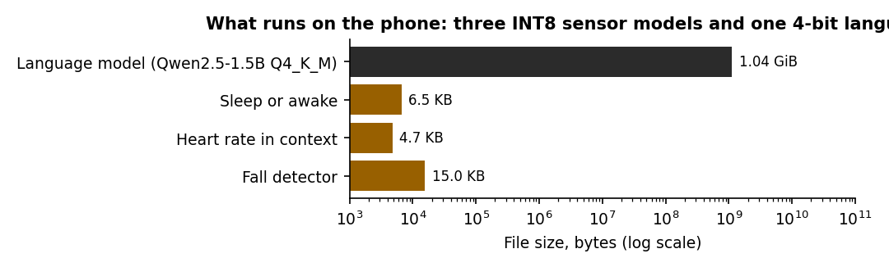</p>

The three sensor models together are 26.2 KB; the language model is 1.04 GiB, 90 % of the
debug APK. Quantisation, measured:

<p align="center">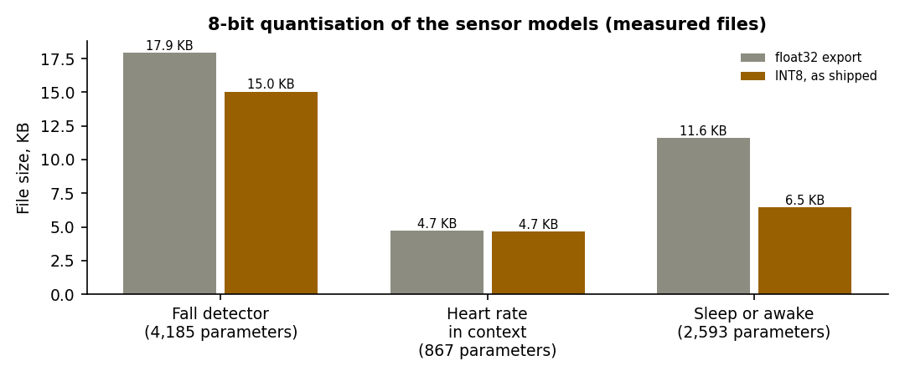</p>

For models this small most of the file is graph structure, so 8-bit saves little space
(fall 17.9 → 15.0 KB, heart rate 4.7 → 4.7 KB, sleep 11.6 → 6.5 KB). The reason to quantise is that integer models run on NPUs such as Qualcomm's
Hexagon, and on AI Hub's Snapdragon phones all three do, on every layer; the cost is measured above (7 of 5,334 fall decisions change).

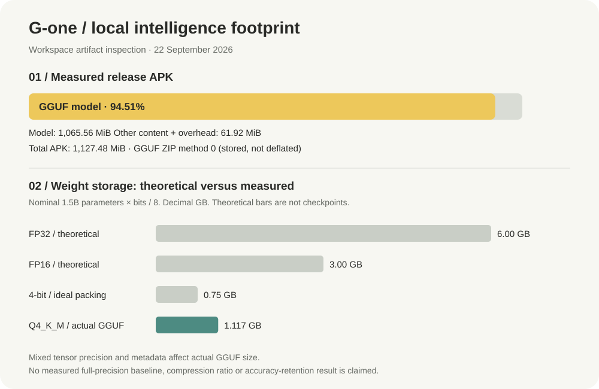

The lower chart is arithmetic for a nominal 1.5-billion-parameter model (FP32 6.0 GB, FP16
3.0 GB, ideal 4-bit 0.75 GB), not a measured benchmark; the real Q4_K_M file is 1.117 GB because
of mixed tensor precision and metadata. [Method](docs/assets/README.md).

## Design comparisons

| Decision | G-one | The alternative, and why not |
|---|---|---|
| Who decides an alert | Named rules; models only supply scores | An end-to-end model is harder to test, explain and bound |
| What the LLM may do | Reword, under number validation | Letting it judge would make every alert depend on generation |
| Where models run | Phone, offline, INT8 | Cloud inference needs a network exactly when it may be missing |
| How models are checked | Held-out people, a whole unseen dataset, the rule they would replace | Window-level splits leak the same person into training and test |
| Fall SOS | Sent at once; a cancel window is offered but off by default | A window delays help for an unconscious wearer; without one, a hard knock texts the contact |
| Disaster alerts | Government CAP feed, matched on the phone | Sending location to a server to match alerts exposes where the wearer is |
| Environment for heat rules | Strap sensor first; city weather capped and labelled | Treating a city's weather as the air around a person over-alerts |
| Emergency NFC | Stable link to an updatable record | A static tag must be rewritten after every edit |

## Build and run

**Prerequisites:** JDK 17, Android SDK 36, NDK 28.2.13676358, CMake 3.22.1, an ARM64 phone on
Android 7.0+ with about 3 GB free.

```powershell
powershell -ExecutionPolicy Bypass -File tools\fetch_model.ps1   # the pinned language model
.\gradlew.bat :app:assembleDebug
.\gradlew.bat :app:testDebugUnitTest :app:lintDebug
.\gradlew.bat :app:connectedDebugAndroidTest                    # with a phone connected
python -m pytest ml/tests
python tools/wearable-emulator/emulate.py --selftest
```

**Rebuild the trained models** (Python 3.11, `ml/requirements.txt`): `python -m ml.run_all`.
**Time them on Snapdragon:** configure your own Qualcomm AI Hub token, then `python -m ml.aihub.profile`
([instructions](ml/README.md#snapdragon-timing-qualcomm-ai-hub)).
**Release builds** read signing details from a local, git-ignored `keystore.properties`.
**CI** runs the unit tests, lint, the model checks and the protocol self-test on every push.

**First run:** install; let the model be prepared; choose the wearable on the Device screen (or a
simulator scenario); grant Bluetooth and notifications; start monitoring. Switch on Air quality,
Your area, emergency sharing and Automatic SOS separately, each when you want it.

## Repository map

```text
app/src/main/java/com/gone/ai/
  ai/ chat/            shared local LLM runtime, prompts, context budgets
  ml/                  NEW · feature code, LiteRT runner, model registry, sleep estimator
  health/
    source/ ble/       parsing, validation, aggregation, the Bluetooth link
    service/           foreground monitoring service and the ordered pipeline
    detect/ domain/    the 15 rules, thresholds, baseline, risk scores, model signals
    explain/           written explanations and rewrite validation
    sos/               automatic texting and calling, the fall cancel window
    disaster/          NEW · SACHET CAP parsing, district matching, NDMA guidance, IMD terms
    environment/       air quality, NEW · weather, India AQI, area repository and job
    emergency/ nfc/    emergency snapshot, NFC tags, QR
    session/ ui/       sessions, PDF reports, health screens
  ocr/ pdf/ circle/    text from images, documents and screens
  ui/                  screens (NEW · Model Lab), navigation, theme
app/src/main/assets/ml/   NEW · three .tflite models, manifest with checksums, demo recordings
app/src/main/cpp/         JNI bridge and vendored llama.cpp/ggml
app/src/test/             JVM tests and golden files    app/src/androidTest/  on-device tests
ml/                       NEW · data preparation, training, tests, AI Hub profiling, charts
firmware/                 strap firmware, owner's reference sketch, pin tracer
hardware/                 strap, PCB and Jeevan Core design models
tools/                    wearable emulator and checker, model fetch script
docs/                     guides; VERIFICATION.md holds the run log
```

## Advantages, limits and next steps

**Advantages**
- Alerts are explainable and testable: every one comes from a named rule with a test.
- Trained models with honest, person-held-out evaluation against the rules they would replace.
- Works offline end to end; area alerts and weather degrade to cached values, never to silence.
- Official, government-issued disaster alerts, matched without sending location.
- A fall can be cancelled; nothing else is delayed.
- Reproducible: pinned language model, scripted model training, checksummed model files, CI, MIT licence.

| Limit today | Next step |
|---|---|
| Strap heart rate blocked by missing 2.2 kΩ pull-ups; unstable power | Fit the resistors, then confirm heart rate against a manual count |
| Firmware is live-only | 72-hour store-and-forward on the board's flash, using the protocol the app already speaks |
| Fall model cannot see strap movement | Send a 4-s window on impact; then run the INT8 model on the ESP32-S3 |
| No ambient sensor on the strap | A BME280; the app already parses `ATEMP`/`HUM` |
| Language model is CPU-only; no Snapdragon phone in hand | Ship the NPU delegate for the small models and try an Adreno build of the LLM on a Snapdragon phone |
| Database not encrypted | SQLCipher with a Keystore-held key |
| One strap only | Health Connect import, standard Bluetooth heart-rate straps, Wear OS |
| Stress is self-reported | A heart-rate-variability model once beat intervals reach the app |
| Thresholds and models tested on volunteers | Evaluation with clinical oversight |

No claim is made for certification, diagnosis, guaranteed fall detection, waterproofing or battery
life. G-one records and explains readings; it does not diagnose.

## Documentation

| Guide | Contents |
|---|---|
| [Trained models](docs/MODELS.md) | Data, method, every figure and limit for the three models |
| [Disaster alerts, weather, India AQI](docs/DISASTER-ALERTS.md) | Sources, matching, privacy, IMD and CPCB terms |
| [Automatic SOS](docs/SOS_BEHAVIOR.md) | What sends, the fall window, what never sends |
| [PS26181 traceability](docs/PS26181-TRACEABILITY.md) | Each requirement → code, tests, evidence, gaps |
| [Demo script](docs/DEMO-SCRIPT.md) | Five minutes, only what works today |
| [ml/README](ml/README.md) | Reproducing the models; Qualcomm AI Hub |
| [Complete project description](docs/G-ONE-COMPLETE-DESCRIPTION.md) | The whole project in one read, hardware included |
| [Wearable protocol](docs/WEARABLE_PROTOCOL.md) · [Hardware setup](docs/HARDWARE_SETUP.md) | The link and the strap |
| [NFC emergency sharing](docs/NFC-EMERGENCY-SHARING.md) · [AQI and wellness](docs/OPTIONAL-AQI-WELLNESS.md) | Optional features |
| [Verification record](VERIFICATION.md) | What was run and what it showed |

---

<div align="center">

**G-one — Sense · Decide · Explain · Belong**

*Rules decide. Models are sensors. The language model only rewords.*

MIT licensed · third-party terms in [NOTICE](NOTICE) · README checked against this workspace on 4 October 2026

</div>
