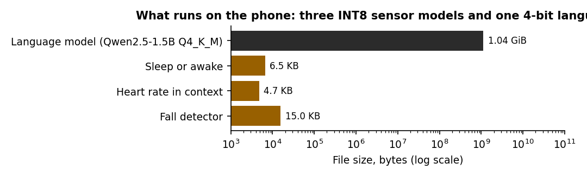
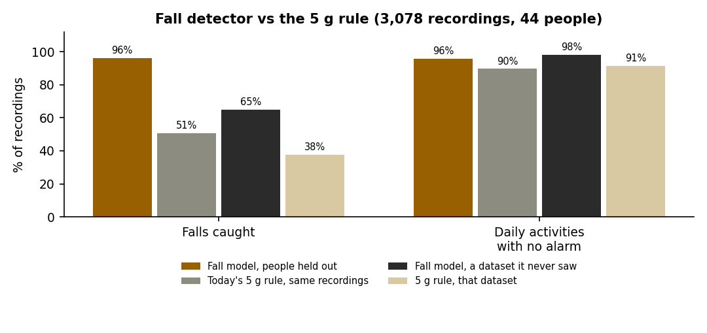
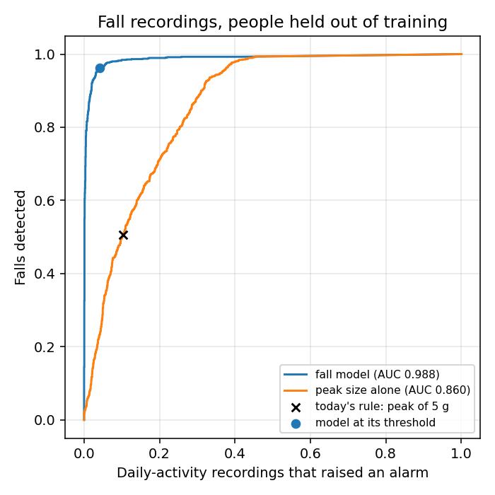
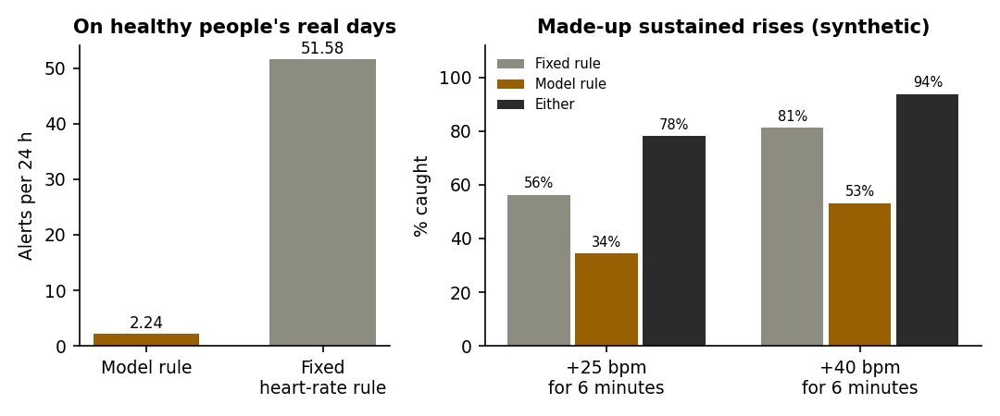
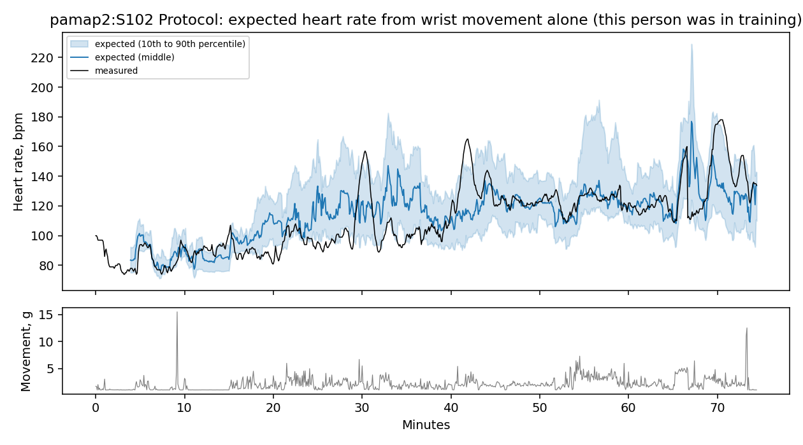
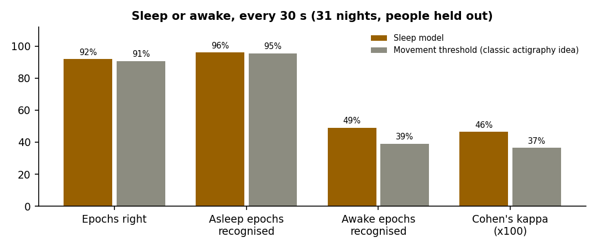
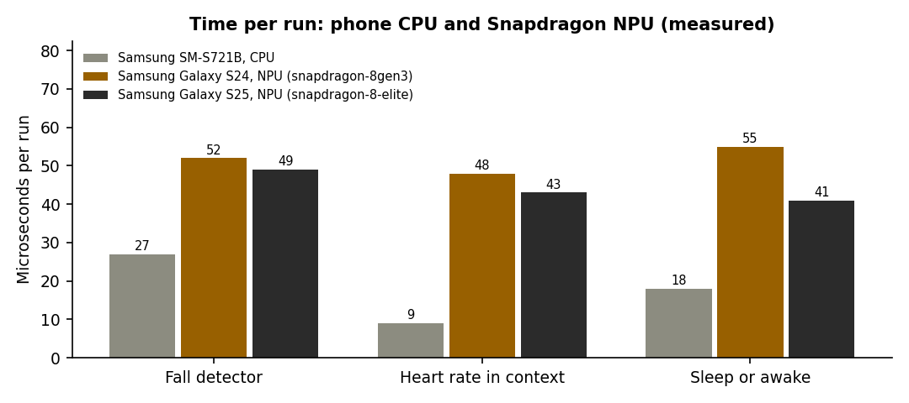

# The trained models

G-one ships three small trained models besides its rule engine and its language model. Each was
trained on a public dataset, tested on people it never saw, converted to 8-bit (INT8) TensorFlow
Lite, and runs on the phone through LiteRT. Everything on this page is measured; the raw numbers
are in `ml/reports/*/metrics.json`, written by the training scripts in [`ml/`](../ml/README.md).

> **Models are sensors. Rules decide. The language model only rewords.** A model produces a
> score. A named rule with fixed thresholds decides whether that score is an event. Model-only
> findings never go above MODERATE and never send an SOS.

| | Fall detector | Heart rate in context | Sleep or awake |
|---|---|---|---|
| File | `fall_v1.tflite` | `hr_context_v1.tflite` | `sleep_v1.tflite` |
| Parameters / size | 4,185 / 15.0 KB | 867 / 4.7 KB | 2,593 / 6.5 KB |
| Input | 4 s of 3-axis movement at 25 Hz around an impact | 7 movement summaries of the last 5 min | 21 × 30 s epochs of movement |
| Output | Probability of a fall | Expected heart rate: 10th, 50th, 90th percentile | Probability asleep |
| Learned from | WEDA-FALL + UMAFall, 44 people, 3,078 recordings | PAMAP2, 9 people, 10.7 h | Walch et al., 31 nights (lab-scored) |
| Tested | 5-fold by person + a whole unseen dataset | Leave one person out | 5-fold by person |
| In the app | Model Lab (replay and live phone sensor) | Rule `ml.hrContext` in live monitoring; Model Lab | "Estimated sleep" on the Sleep card |

---

## 1. Fall detector (`fall_v1`)

**Question it answers:** was this impact a fall, or a knock, a clap, a jog, a slap on the table?

**Data.** WEDA-FALL (Marques & Moreno 2023: wrist, 14 young people performing 8 kinds of fall and
11 daily activities, plus 11 people aged 77–95 doing the daily activities) and UMAFall (Casilari
et al. 2017: 19 people, sensors at wrist, pocket and waist). 3,078 recordings, 44 people, 5,334
impacts scored. Everything is resampled to 25 Hz, in g, clipped to ±4 g per axis (the limit of
the wrist sensor in the training data).

**Model.** An impact is any moment of at least 2 g that is the largest in the half second around
it. The model reads the 4 seconds around it (1 s before, 3 s after): x, y and z over 4 g and the
magnitude over 7 g, 100 × 4 numbers. A small depthwise-separable 1D CNN, trained with random
rotation (so it does not depend on how the device is worn), ±10 % scaling and small time shifts.

**Test.** Five folds, split by person. A fall recording counts as caught when the impact inside
its marked fall is scored above the threshold; a daily-activity recording counts as an alarm when
any impact in it is. The 5 g rule G-one uses today is scored on the same recordings, from the
highest raw sample in each 1/25 s (the strap keeps the peak between reports). The threshold
(0.647) was chosen on the cross-validated scores, which flatters it slightly.

| People held out | Falls caught | Daily recordings with no alarm | F1 | Alarms / hour of hard activities |
|---|---|---|---|---|
| **Fall model** | **96.2 %** | **95.9 %** | **0.94** | 11.6 |
| Today's 5 g rule | 50.7 % | 89.6 % | 0.58 | 67.5 |
| Best single peak threshold (2.69 g) | 93.6 % | 66.7 % | 0.70 | 424.5 |
| **On a dataset it never saw** (trained on WEDA-FALL only, tested on UMAFall) | | | | |
| Fall model | 64.8 % | 98.1 % | 0.76 | 5.3 |
| 5 g rule | 37.7 % | 91.4 % | 0.47 | 64.0 |

Area under the ROC curve: 0.988 for the model, 0.860 for peak size alone. Spread across folds:
±1.8 points (falls caught), ±2.1 points (no alarm). On the daily activities of the 11 people aged
77–95 the model raised **no** alarm (157 recordings); the 5 g rule raised one on 17 % of them.

**By position (people held out).** Wrist: 93.8 % caught / 95.2 % no alarm (UMAFall), 98.9 % / 92.7 %
(WEDA-FALL). Pocket: 96.2 % / 97.8 %. Waist: 94.2 % / 98.8 %.

**8-bit.** 7 of 5,334 decisions differ between the float and the INT8 model; the largest score
difference is 0.12.

**Honest limits.**
- The falls are performed by volunteers onto mats, not real falls; the alarms-per-hour figure is
  for dense, deliberately fall-like daily activities, not a normal day.
- Across datasets the model catches far fewer falls (64.8 %). It is the more honest number for a
  new device.
- **The strap cannot use it yet**: it sends one peak value twice a second, not the 4-second
  movement window the model needs. The strap's falls still go through the 5 g rule (which also
  starts the "I'm OK" countdown). Sending the window, then running the model on the ESP32-S3
  itself, is the next firmware step.
- In the app today it runs in the Model Lab, on the phone's own accelerometer or on recordings.

---

## 2. Heart rate in context (`hr_context_v1`) and the rule `ml.hrContext`

**Question it answers:** is the heart rate higher than what the person has been doing would explain?

The fixed heart-rate rule only warns at rest (130+) or at 150+, and the baseline rule only at
rest. A rate of 140 while slowly walking passes both. This model learns what heart rate usually
goes with the last 5 minutes of wrist movement, relative to the person's own resting rate.

**Data.** PAMAP2 (Reiss & Stricker 2012): 9 people, a wrist accelerometer and a heart-rate strap,
18 activities from lying to rope jumping. Turned into exactly what the app stores: one reading
every 5 seconds with the largest movement in g and the median heart rate. Resting rate is worked
out as the app does (`PatientBaseline`: mean heart rate of readings at rest).

**Model.** 7 numbers (mean activity over the last 30 s, 1, 2 and 5 min; largest and spread over
the last minute; share of the last 5 min spent moving) → a tiny network → the 10th, 50th and 90th
percentile of heart rate above resting (quantile loss).

**The rule** (`HeartRateContextRule`): LOW when 90 % of the last 3 minutes are 10+ bpm above the
band's top; MODERATE when 90 % of the last 5 minutes are 30+ bpm above it. Never CRITICAL, never
an SOS, silent wherever the fixed rule would fire, silent without a reliable resting rate.

**Test.** Leave one person out; the model never saw the person it is tested on.

| Expected-rate error (people held out) | Mean | Median |
|---|---|---|
| **Model** | **14.1 bpm** | **10.8 bpm** |
| Guessing the resting rate | 23.0 bpm | 16.2 bpm |
| Straight-line fit on the same 7 numbers | 14.2 bpm | 11.1 bpm |

| The rule on held-out recordings (10.7 h) | Model rule | Fixed heart-rate rule |
|---|---|---|
| Alerts on healthy people's real activity (all unwanted) | **1 (2.2 a day)** | 23 (51.6 a day) |
| Made-up +25 bpm for 6 min (32 trials, synthetic) | 34 % caught | 56 % caught |
| Made-up +40 bpm for 6 min (32 trials, synthetic) | 53 % caught | 81 % caught |
| Caught by either rule (+25 / +40) | 78 % / 94 % | |
| Caught only by the model rule (+25 / +40) | 22 % / 13 % | |

Median time to the model rule's alert: 3.5 min (+25) and 2.7 min (+40).

**Honest limits.**
- The model is barely better than a straight line on the same inputs (14.1 vs 14.2 bpm). Its value
  is the calibrated band plus a conservative rule: very few false alarms, and catches that the
  fixed rule misses. It is an early hint, which is why it can never send an SOS.
- The band covers 64 % of measured rates, not the intended 80 %: it is too narrow for new people.
  The rule's 10 and 30 bpm margins and 90 % persistence compensate for that.
- 9 young, healthy people. The made-up rises are synthetic.
- The strap does not deliver heart rate yet (missing pull-up resistors), so on the real strap
  this rule is silent; it is shown with the simulator and the Model Lab replay.

---

## 3. Sleep or awake (`sleep_v1`)

**Question it answers:** for each 30 seconds of the night, was the wearer asleep or awake?

**Data.** "Motion and heart rate from a wrist-worn wearable and labeled sleep from
polysomnography" (Walch et al. 2019, PhysioNet, ODC-By 1.0): 31 people, one night each in a sleep
lab, an Apple Watch's movement and the lab's sleep scoring (polysomnography, the clinical
standard). 25,395 scored epochs; 8.5 % of them awake. Each night was turned into what the app
stores: one reading every 5 s with the largest movement in g.

**Model.** Per 30-second epoch: the mean and the largest movement above gravity (log-scaled) and
whether the epoch has data. The model sees the epoch and ten on each side (21 × 3 numbers) and
outputs the probability of sleep. A tiny network, 2,593 parameters, 6.5 KB as INT8. Movement only,
because that is what the strap sends today.

**Test.** Five folds, split by person. The model and a plain movement threshold (the idea behind
classic actigraphy) each get their cut-off the same way: the best Cohen's kappa on the training
folds, then applied unchanged to the held-out nights.

| Nights held out (31) | Epochs right | Asleep recognised | Awake recognised | Cohen's kappa | Total-sleep error a night |
|---|---|---|---|---|---|
| **Sleep model** | **91.9 %** | **95.9 %** | **49.1 %** | **0.46** | **17.4 min** |
| Movement threshold | 90.7 % | 95.5 % | 39.0 % | 0.37 | 19.7 min |
| Always saying "asleep" | 91.5 % | 100 % | 0 % | 0 | — |

**8-bit.** 7 of 5,000 epoch decisions differ between the float and the INT8 model.

**In the app.** The Sleep card runs the model over last night's stored wearable readings (6 pm to
noon, simulated readings excluded) and, when at least 70 % of the night has readings and there is
an hour or more of sleep, shows "Estimated from the wearable": time asleep, when the wearer fell
asleep and woke, minutes awake. "Use as a diary entry" opens the usual dialog pre-filled; the
quality rating and the decision to save stay the wearer's. The Model Lab replays one recorded
night against the lab's scoring.

**Honest limits.**
- Epoch accuracy barely beats always saying "asleep" (91.9 % vs 91.5 %), because most of a night is
  sleep. Kappa and awake-recognition are the meaningful numbers, and wrist movement alone finds only
  about half of the awake epochs: lying still while awake looks like sleep. That is a known limit of
  movement-only sleep estimation.
- The data come from an Apple Watch, sampled more slowly than the strap; the strap's peak readings
  will differ somewhat. Not checked on the strap yet.
- It estimates asleep or awake, not sleep stages, and it is not a sleep study.

---

## Reproducing and checking

- `python -m ml.run_all` rebuilds every model from the public datasets; `python -m pytest ml/tests`
  checks the specifications and the shipped files' checksums.
- The app refuses a model whose SHA-256 does not match `app/src/main/assets/ml/manifest.json`.
- `FallWindowTest`, `HrContextTest` and `SleepTest` (JVM) require the Kotlin feature code to
  produce what the Python code produced from the same real recordings. `ModelOnDeviceTest` (on a
  phone) requires LiteRT's outputs to match TensorFlow Lite's from training.
- **Measured on a phone** (Samsung SM-S721B, Exynos, CPU, median of 200 runs, 4 October 2026):
  fall 15–27 µs, heart rate in context 9 µs, sleep 18 µs per run. `ModelOnDeviceTest` passed: LiteRT's
  outputs equal training's within 0.02 for the fall and heart-rate models.
- **Measured on Snapdragon** (Qualcomm AI Hub hosted phones, TensorFlow Lite runtime with
  Qualcomm's NPU delegate, 4 October 2026, `ml/aihub/profile.py`; raw profiles in
  `ml/reports/aihub/`):

| Model | Galaxy S24 (Snapdragon 8 Gen 3) | Galaxy S25 (Snapdragon 8 Elite) | Layers on the NPU | SM-S721B (Exynos), CPU |
|---|---|---|---|---|
| Fall detector | 52 µs | 49 µs | 12 of 12 | 15–27 µs |
| Heart rate in context | 48 µs | 43 µs | 5 of 5 | 9 µs |
| Sleep or awake | 55 µs | 41 µs | 6 of 6 | 18 µs |

  

  **Every layer of every model runs on the Snapdragon NPU**, which is what 8-bit quantisation was
  for. It is not faster there than on a CPU: these models are so small that handing the work to
  the NPU costs more than the work itself (about 45 µs against 9–27 µs). Either way a reading
  every 5 seconds leaves five orders of magnitude to spare. Peak memory during the profile was
  120–149 MB, which is the runtime, not the model. The language model has not been run on a
  Snapdragon NPU or GPU; it stays on the CPU.
